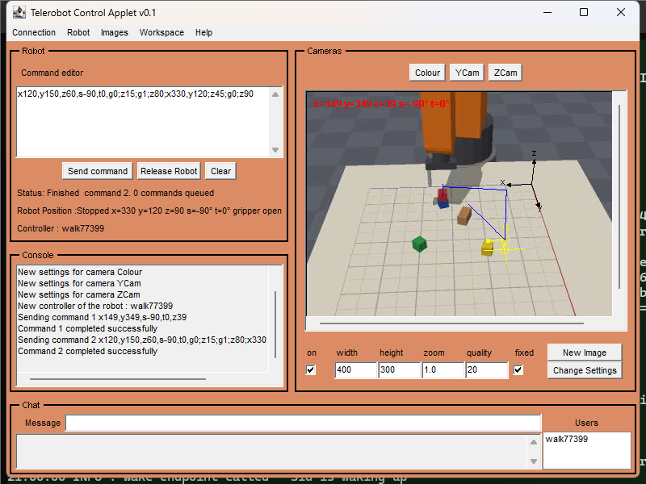

# UWA Telerobot

From 1994 the University of Western Australia ran one of the first robots
anyone could control over the web: an ABB industrial arm above a table of
wooden blocks, with cameras so you could watch your moves. This repository is
the 1999–2000 version of its software, written by Barney Dalton for his PhD.
It puts the arm, the cameras and every user into shared sessions on a
middleware server called MOM, and gives users a Java applet to drive the robot,
see the camera images and chat.

The arm and cameras are long gone, so this repository adds a **virtual lab**: a
simulated arm with blocks it can pick up and stack, and simulated cameras that
render it. The original servers and applet run against it unchanged, so you can
drive the 2000 interface again.



## Quick start

You need **JDK 8** (the last JDK with `appletviewer`) and **Maven**.

```sh
mvn package          # on JDK 8: builds lab/target/telerobot.jar and runs the tests
./start.sh           # or .\start.ps1 on Windows; stop with ./stop.sh / .\stop.ps1
```

The repository is a Maven multi-module build: `lab` holds the original code, the
simulator and the tests (it builds on JDK 8 and produces `lab/target/telerobot.jar`),
and `gateway` is the web gateway, which needs JDK 21. The gateway module joins the
build only on JDK 21 or later (the root pom's `gateway` profile), so `mvn package`
on JDK 8 builds the lab and the local applet, and on JDK 21 it builds everything,
`gateway/target/gateway.jar` included. All the servers listen on `127.0.0.1`
only; set `-Dtelerobot.bind=<address>` to listen elsewhere. The virtual lab also
has an admin port (30564, same address) where the line `reset` puts the arm
and blocks back to the start.

The control applet opens in its own window:

1. Log in as `guest` (no password) with any nickname.
2. Press **Control Robot**.
3. Type a command such as `x200,y150,z40;g1` and press **Send command**, or
   drag the yellow 3D cursor over a camera image and choose
   **Robot ▸ Comand from cursor**.

The camera images are augmented with overlays drawn from each camera's
calibration: the yellow stick cursor, the blue path of commanded moves, the x/y/z axes,
the cursor's coordinates in red, and shared workspace points. The **Images**
menu turns them on and off, and **Workspace** has measuring tools.

Enlarge the window to enlarge the camera image; the overlays and cursor scale
with it. For a sharper picture, raise the camera's width and height (up to
768×576) and press **Change Settings**.

Commands are path scripts: waypoints separated by `;`, each setting axes
`x y z` (mm), `s` (spin), `t` (tilt) and `g0`/`g1` (open/close the gripper).
[web/help.html](web/help.html) has the details. To stack the red block on the
blue one:

```
x120,y150,z60,s-90,t0,g0;z15;g1;z80;x330,y120;z45;g0;z90
```

The first waypoint sets spin and tilt and opens the gripper, because a closed
gripper can't grip and the gripper only grips with the tilt within ±20°. Blocks stay where they are left until the stack is restarted.

Logs go to `run/`. User accounts are in [config/users.ini](config/users.ini).
The `team` account (PIN `1234`) can take control from guests; change the PINs
before running MOM anywhere but localhost.

## How it fits together

```
 TA200001 applet ──┐                       ┌── RobotProxy ── control/position sockets ──┐
 (control, images, │                       │   (devices.robot.Server)                    │
  chat, workspace) ├── MOM server :4444 ───┤                                             │
 other applets ────┘   (mom.server)        └── camera server ─┐           VirtualLab:    │
                                               (devices.camera.Server)    VirtualRobotServer
                                                              │           World (arm + blocks)
                                                              └── SimCameraManager → Renderer
```

* **MOM** (`au.edu.uwa.mech.mom`) is the middleware. Clients log in and join
  nested *sessions*, which contain *channels* for messages and *tokens* for
  taking turns. Sessions are kept in step for everyone in them. It runs over
  sockets (`moms://user:pin:nick@host:port/`) or RMI.
* **RobotProxy** (`devices.robot.Server`) owns the `robot` session. It passes
  commands from whoever holds `robot.token` to the RobotServer and streams the
  robot's position back. Control is "hold until wanted": a user keeps the robot
  until someone with a higher user level takes it, or until 180 s after they
  last took control.
* **Camera server** (`devices.camera.Server`) owns the `cameras` session, with
  one channel per camera. It photographs every 500 ms while the robot moves and
  sends each JPEG with the camera's 3×4 calibration matrix, so clients can draw
  3D overlays on the images.
* **TA200001** (`applets.TA200001`) is the February 2000 control applet: a
  command editor, camera views with a draggable 3D stick cursor, measuring tools
  and a path overlay, shared workspace points, and chat.
* **VirtualLab** (`sim`) replaces the hardware. `VirtualRobotServer` speaks the
  protocol of the original C++ RobotServer: GBH path scripts in,
  `major minor "text"` results back, and a stream of
  `x y z 1 spin tilt gripper 0 0 Moving|Stopped` position lines. `World` holds
  the arm and five blocks; closing the gripper around a block picks it up, and
  opening it drops the block onto whatever is below. The three cameras (Colour,
  YCam and ZCam, named after the originals) render the scene with a small
  software rasteriser. Their calibration matrices come from the same camera
  model, so the overlays line up exactly.

To render the cameras without starting anything else:

```sh
java -cp lab/target/telerobot.jar au.edu.uwa.mech.sim.VirtualLab --preview previews/
```

## Tests

`mvn test` runs unit tests covering:

* the path-script parser,
* the overlay camera model, the rendered cameras and the calibration solver,
  which must agree with each other,
* the original client code parsing the virtual robot's results and positions,
* a full pick-up-and-stack,
* the serialization allowlist (`util.SerialFilter`, for the JVM's
  `jdk.serialFilter`; that test needs JDK 9+ and is skipped on JDK 8),
* the world reset and the loopback binding of the servers.

The tests also write `webui/test/fixtures/camera.json`, the camera geometry
reference values for the browser port.

`lab/src/test/java/au/edu/uwa/mech/it` has two checks to run against a stack
started with `NO_APPLET=1 ./start.sh` or `.\start.ps1 -NoApplet`:

* `SmokeCheck` logs in headless, takes control and makes a move.
* `AppletWalkthrough <outdir>` runs the real applet in-process and works it
  through its own widgets. It logs in, waits for camera images, drags the
  stick cursor, sends **Comand from cursor**, checks the robot got there, runs
  a pick-and-place, and saves a screenshot after each step.

```sh
java -cp "lab/target/telerobot.jar:lab/target/test-classes" au.edu.uwa.mech.it.AppletWalkthrough walkthrough/
```

## Notes

* Applets need JDK 8's `appletviewer`; browsers dropped Java plugins long ago.
  On some Windows machines Java 8's Direct3D pipeline doesn't paint the camera
  canvases, so the start scripts pass `-Dsun.java2d.d3d=false`.
* The camera settings panel works (size, JPEG quality). Zoom and "fixed" are
  stored but ignored, because the simulated cameras don't pan or zoom.
* `mom.applications.HintServer`, `ChatLog` and `model.WorkspaceServer` build
  but aren't started by the scripts.
* Some of the 1999–2000 sources were third-party libraries or depended on them,
  and the robot and camera servers were partly native code. What was removed,
  replaced or rewritten for this release is listed in
  [docs/PROVENANCE.md](docs/PROVENANCE.md).

## Licence

GNU General Public License, version 2 or (at your option) any later version.
See [LICENSE](LICENSE). The original sources carry the same terms in their
headers.
